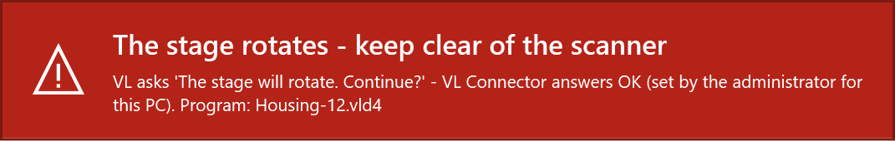

# VL Connector for PolyWorks - Notes for IT

This page explains what VL Connector installs and runs, what it changes on a PC and why, so that IT can review
it before use. Everything is **readable source**: Windows PowerShell 5.1 scripts, PolyWorks macros (MSCL), WPF
window definitions (XAML), C# source for the few Windows functions PowerShell cannot call directly, and JSON
settings. The only compiled file is the interface DLL that the **installer** builds once from the shipped C#
source on the PC; nothing is compiled at run time.

Unofficial tool - not an official KEYENCE or InnovMetric product. License: MIT.

**In short:** installed by an administrator into `C:\Program Files\VLConnector`, which only administrators can
change. Settings that matter for safety and for IT (the VL program, the automatic stage confirmation, dialog
rules) can only be set by an administrator, for all users of the PC. No service, driver, scheduled task or
PolyWorks plug-in; no internet access, no telemetry.

## 1. Components

| File | Runs | Purpose |
|---|---|---|
| `app\VLConnector.ps1` | when a user opens it (Start menu; the installer offers the wizard) | Settings window and setup wizard (WPF). |
| `app\Set-MachinePolicy.ps1` | only with administrator rights, from the *Change (administrator)* button (UAC prompt) | Small dialog that writes the machine policy (`machine.json`) and an Event Log entry. |
| `app\Agent.ps1` | scenario B, scanner PC: at logon (only if the user switched it on) or from the Start menu | Notification-area agent: starts the launcher in watch mode, sends STL files to the shared folder, opens the user's reports. Its network work runs in `app\lib\AgentCycle.ps1`. |
| `app\VLReplay.ps1` | started by the PolyWorks Measure macro or by the agent (`-Watch`) | Drives AI Replay in the VL Application (or follows a replay the operator started) and exports the STL. |
| `app\polyworks\*.pwmacro` | inside PolyWorks, when the user presses the button | Evaluation, report, network station loop. |
| `app\polyworks\*.ps1` | started by the macros | Settings for the macros (`Get-MacroContext`), the verdict and CSV (`Complete-Evaluation`), the station's file work (`Station-Step`). |
| `app\interop\*.cs` | compiled once by the installer | Windows and PolyWorks interface declarations, see section 7. |
| `bin\VLConnector.Interop.dll` | loaded by the scripts | Built by the installer from `app\interop\*.cs`; carries the SHA-256 of its source in its file properties. |
| `app\lib\*.ps1` | loaded by the scripts above | Shared code, e.g. `Install.ps1` (installation), `Settings.ps1` (settings layers), `StageWarning*.ps1` (warning window). |
| `Install.ps1`, `Uninstall.ps1` | by an administrator | Installation, update, removal. |
| `tools\Sign-Package.ps1` | by IT, optional | Signs the package with your certificate before deployment (section 6). |
| `tools\Build-Interop.ps1` | by the installer (or IT) | Builds the interface DLL from the source. |

No service, scheduled task, driver or browser extension is installed. The only autostart is the optional
Startup-folder shortcut of the agent (per user, switched on by the user). While it waits for AI Replay, the
agent's launcher looks at the VL windows of the user's session about every 0.25 s (window list and texts only).

## 2. Installation and trust model

**Install** (an administrator; or software deployment as SYSTEM):

```
Install.cmd                                  interactive: a user starts it, Windows asks for administrator rights
Install.cmd -Quiet [-ConfirmStageMotion On|Off] [-MachineSettings <file>] [-InteropDll <file>] [-InstallDir <folder>] [-Force]
```

Exit codes: `0` done, `1` failed, `2` cancelled, `740` administrator rights needed (`-Quiet` as a user),
`1618` VL Connector is in use (a window, a scan or a station step runs in some session: retry later).
Detection rule for deployment tools: `C:\Program Files\VLConnector\install-info.txt` (line `VERSION=`).

What the installer does, as administrator:

1. Reads the package manifest (`MANIFEST.sha256`, SHA-256 of every file) **once** into memory and checks every
   file; shows the package fingerprint (SHA-256 of the manifest) for comparison with the published one.
2. Refuses an install folder that is relative, a drive, Windows or a shared folder itself, a link, a folder
   with other content, the package folder itself, a folder whose parent folders users could delete, rename or
   re-permission, and an older version over a newer one (without `-Force`).
3. Creates `<folder>.new` with an **administrator-only ACL** (no inheritance; SYSTEM and Administrators full
   control, Users read and execute; owner Administrators), copies only the files of the manifest and checks
   each copy against the manifest in memory. Only these files lose the "downloaded from the internet" mark.
4. Builds the interface DLL there (or takes `-InteropDll`, a DLL IT built and signed from the same source,
   checked by its source hash), writes the PolyWorks button files and `install-info.txt`, keeps `machine.json`.
5. Checks the staged copy strictly (extra files and links are errors) and its ACL, stops the VL Connector agents
   of all sessions, and swaps the folders by renaming. The previous version stays in `<folder>.old` and is put
   back when the swap fails.
6. Registers the event source "VL Connector" (Application log), applies `-MachineSettings` and
   `-ConfirmStageMotion` (checked before step 3), creates the Start menu entries for all users.

When a user starts `Install.cmd`, the package is first copied to the user's `%TEMP%` (an elevated process does
not see mapped drives), the machine part runs elevated, and then the user's own shortcuts and settings are
brought up to date. Started elevated or as SYSTEM, only the machine part runs; each user's part runs when that
user next starts VL Connector.

**Nothing writes into the program folder at run time** - except `machine.json`, and only through the
administrator tool (UAC).

**1.0.0-rc10 installations** (in `C:\ProgramData\VLConnector`, a folder users could change): the installer
renames the folder away (nothing inside is followed), creates a new administrator-only folder in its place that
holds only **forwarders** - small files that pass old PolyWorks buttons and old shortcuts on to the new folder -
and deletes the old content without following junctions or links. From its `machine.json` only shared
defaults are taken over, nothing only an administrator may set. The installer lists the users whose own settings
had switched the automatic stage confirmation on; that is ignored now.

**Check an installation:** `Install.cmd -Verify` (no administrator rights needed) checks the files against the
manifest, the ACL of the folder and its parents, and the interface DLL against its source - **before** it loads
any installed code - then shows the status of the PC.

**Remove:** Start menu > Uninstall VL Connector, or `Uninstall.cmd [-Quiet] [-RemoveUserData]` (administrator).
It runs from a temporary copy, stops the agents, removes the program folder (with `.old`), the Start menu
entries, the agent startup shortcuts of all users, the forwarders and the event source, and checks that the
folder is gone. User data (`-RemoveUserData`: the settings and logs of the user who runs it), scans, reports,
PolyWorks projects and the shared folder stay.

## 3. Settings and their lock

Four layers; a later one overrides single values of an earlier one:

1. `app\config\defaults.json` (product defaults),
2. `machine.json`, section `defaults` (starting values of IT; users may change them),
3. `%APPDATA%\VLConnector\settings.json` (the user's own changes),
4. `machine.json`, section `policy` (values IT locks for all users).

`machine.json` lies in the program folder, next to `app\`; its place never comes from an environment variable.
Every value of every layer is checked against `app\config\settings-schema.json` (JSON types are taken
literally: the text `"true"` is not true). A value that does not pass is ignored with a warning on the Setup page.

**Only an administrator** can set these keys, in `defaults.json` or the `policy` (anywhere else they are
ignored): `vl.exe`, `vl.args`, `vl.confirmStageMotion`, `vl.dialogRules`, `vl.testedVersions`,
`vl.menuExportStl`, `vl.menuSaveAs`, `network.allowUncWorkspaces`, `safety.stageWarningSec`,
`safety.stageSound`, `safety.watchAllowClose`. Users see locked settings greyed out with "Set by the
administrator for all users of this PC".

Example `machine.json`:

```json
{
  "policy":   { "vl": { "confirmStageMotion": false }, "network": { "share": "\\\\fileserver\\metrology\\VLConnector" } },
  "defaults": { "polyworks": { "keepPieces": "Nok" } }
}
```

Every settings change is logged (`%LOCALAPPDATA%\VLConnector\logs\Settings_<date>.log`); a change of the
machine settings also goes to the Event Log (event 1000), with the administrator and the user who asked for it.

## 4. Stage rotation safety

The VL Application asks the operator before the turntable moves ("The stage will rotate. Continue?", "Return the
stage to the origin?"). By default **the operator answers**. An administrator can let VL Connector answer them
(`vl.confirmStageMotion` in the policy: installer `-ConfirmStageMotion On`, or the *Change (administrator)*
button). It is a setting of the PC, never of a user, a template or a command line: the launcher has no such
parameter, template options cannot set it, and user settings are ignored.

VL Connector answers a stage question only when **all** of these hold, checked anew for each question:

- the policy is on (re-read at that moment: switching it off takes effect at once),
- the question is exactly one of the two texts above, and the VL version is listed in `vl.testedVersions`,
- somebody can be at the PC: the session is the active console session, not a remote (RDP) session, and the
  screen is not locked,
- the **warning window** is on screen (red, on top of all windows, never takes the keyboard focus, placed so it
  does not cover VL's question) and the sound has played; if Windows has not shown it within 1 s, VL
  Connector does not answer.



Every automatic answer is written to the Event Log, **event 1100** (user, PC, program, the question). A question
VL Connector could have answered but did not, and why, is **event 1101** (warning); the operator answers it.

## 5. PowerShell requirements

- **Windows PowerShell 5.1** (part of Windows 10/11) in **FullLanguage** mode. Every entry script checks the
  language mode first and stops with a clear message (and a result file for the PolyWorks macros) in
  ConstrainedLanguage mode.
- **Execution policy:** the Start menu entries and the PolyWorks macros start the scripts with
  `-ExecutionPolicy RemoteSigned` and the full path of `powershell.exe` in System32 (never one found on the
  search path); `Install.cmd` uses `-ExecutionPolicy Bypass` for the extracted package. A Group Policy execution
  policy always wins.
- Background work (agent cycle, warning window, window jobs) runs **script files** in runspaces, never script
  text, so a script rule for the program folder covers it.

## 6. Code signature and application control

The package carries no personal code signature. Its integrity is shown instead by:

- the **GitHub release** built by GitHub Actions from a tag of the source repository (`.github\workflows\release.yml`,
  actions pinned to commits), with `SHA256SUMS.txt`: the SHA-256 of the ZIP and the package fingerprint;
- optionally a **build attestation** signed by GitHub, naming repository, workflow and commit
  (`gh attestation verify <zip> --repo <owner>/<repo>`);
- `MANIFEST.sha256` inside, checked by the installer and by `Install.cmd -Verify`.

**AppLocker:** the default script rules allow `%PROGRAMFILES%\*`, so VL Connector runs in FullLanguage there
without a signature. For hash rules, generate them with Windows' own cmdlets after the installation:

```
Get-AppLockerFileInformation -Directory 'C:\Program Files\VLConnector' -Recurse -FileType Script, Dll |
    New-AppLockerPolicy -RuleType Hash -User Everyone -Xml > VLConnector-applocker.xml
```

The interface DLL is built on each PC and its file hash differs per PC (the compiler is not deterministic); allow
it by path, or deploy one DLL that IT built and signed (below).

**Your own signature** (AllSigned, WDAC with a signer rule):

```
tools\Sign-Package.ps1 -Package <unpacked package> -Thumbprint <your code signing certificate>
                       -Zip <downloaded ZIP> -Sums SHA256SUMS.txt -InteropDll <folder>\VLConnector.Interop.dll
Install.cmd -Quiet -InteropDll <folder>\VLConnector.Interop.dll
```

It checks the ZIP and the manifest first and signs nothing when a file differs, signs the package's scripts with
a timestamp (stops at the first error), checks that the installer still accepts the package, and can build and
sign the interface DLL. The installer and `-Verify` accept signed scripts: they cut off the signature block and
compare the rest with the manifest.

## 7. What your security software will see

**Processes** (all `powershell.exe` from System32, `-NoProfile`, `-File` with a full path; never
`-EncodedCommand`, never downloaded code):

| Started by | Process | When |
|---|---|---|
| PolyWorks `iminspect.exe` | `powershell.exe ... app\polyworks\Get-MacroContext.ps1`, `Complete-Evaluation.ps1`, `Station-Step.ps1` | every Measure / evaluation / station poll |
| PolyWorks `iminspect.exe` | `powershell.exe -STA ... app\VLReplay.ps1 -LaunchFile ... -MarkerFile ...` | Measure button |
| PolyWorks `iminspect.exe` | `cmd.exe /c DEL`, `MKDIR`, `start "" <pdf>` | macro file work, opening the PDF |
| `explorer.exe` (Startup shortcut) | `powershell.exe -STA ... app\Agent.ps1` | logon, if the user switched it on |
| the agent | `powershell.exe -STA ... app\VLReplay.ps1 -Watch -MarkerFile ...` | while the agent runs |
| the settings window, UAC | `powershell.exe ... app\Set-MachinePolicy.ps1` (elevated) | *Change (administrator)* |
| the installer | `powershell.exe ... Install.ps1 -MachinePart` (elevated), `tools\Build-Interop.ps1` (C# compiler `csc.exe`, once), `icacls.exe`, `takeown.exe` (only for an rc10 folder) | installation |

**Access to the VL process** (`VLApplication4.exe` of the same user; KEYENCE files are never written, VL is
never terminated):

- `OpenProcess` with only `PROCESS_VM_OPERATION | PROCESS_VM_READ`, `VirtualAllocEx` of **1 KB**,
  `SendMessageTimeout(WM_GETCONTROLNAME)` - VL itself writes the name of a WinForms control (e.g.
  `_replayScanButton`) into that buffer - `ReadProcessMemory` of that 1 KB and `VirtualFreeEx`. This is the
  standard technique of UI test tools for WinForms; no `WriteProcessMemory`, no remote thread, no code injection.
- Window messages: `WM_GETTEXT`, `WM_SETTEXT` (the program path in VL's file dialog), `BM_CLICK` (a dialog button
  found by its id, only when enabled), `WM_CLOSE` (only when the user chose to close VL).
- UI Automation on VL's window (menus *File > Export > STL*, *File > Save As*; AI Replay progress).
- `SetForegroundWindow` / `AttachThreadInput` only towards VL, PolyWorks or VL Connector's own windows, and
  `mouse_event` with a **zero-pixel** move: Windows lets only the process with the last input change the
  foreground; the mouse does not move.

**Other:** the interface DLL is loaded from `C:\Program Files\VLConnector\bin\` into the PowerShell processes.
The PolyWorks COM interface is used only by *Add to PolyWorks* (wizard or settings), towards the PolyWorks the
user has open; PolyWorks is never started. Network access only to the shared folder of scenario B (SMB).
Event Log entries: source "VL Connector", events 1000, 1100, 1101.

VL Connector **reads** two VL files: `%APPDATA%\KEYENCE\VL-800 Series\VL Application\VLOperation.log` (when AI
Replay finished) and `%LOCALAPPDATA%\KEYENCE\...\RecentUsedTemplateFiles.xml` (to find programs).

## 8. What is written where

| Path | Content | Written by |
|---|---|---|
| `C:\Program Files\VLConnector\` (and `.old`) | The program, the interface DLL, the PolyWorks button files, `install-info.txt`, `machine.json` | installer; `machine.json` also by the administrator tool |
| `C:\ProgramData\VLConnector\` | Only on PCs that had 1.0.0-rc10: the forwarders (administrator-only) | installer |
| `C:\ProgramData\Microsoft\Windows\Start Menu\Programs\VL Connector\` | Start menu entries for all users | installer |
| `HKLM\SYSTEM\CurrentControlSet\Services\EventLog\Application\VL Connector` | The event source (the only registry key) | installer |
| `%APPDATA%\VLConnector\settings.json` | The user's own settings | settings window, wizard |
| `%LOCALAPPDATA%\VLConnector\` | `logs\` (30 days), agent `inbox\`, `outbox\` (with `failed\`), `pending.txt`, `runs\`, station work files, `polyworks-layout\` (backups of the PolyWorks visual layout made before *Add to PolyWorks*) | all parts |
| `%TEMP%` | Short-lived exchange files between the macros and the scripts (launch, marker, status, cancel, results) | macros, launcher |
| `%APPDATA%\Microsoft\Windows\Start Menu\Programs\Startup\VL Connector agent.lnk` | Only if the user switches on *Start the agent with Windows* | settings window |
| PolyWorks visual layout of the user | Only on *Add to PolyWorks*: a ribbon tab with the button macro; the previous layout is saved first (*Undo*) | settings window, wizard |
| `Documents\VL Connector\` | Scans (STL) and, in scenario B, the received reports (marked as downloaded) | launcher, agent |
| PolyWorks workspace of the part | Measured pieces (copies of the template), `Reports`/`Scans` folders. Templates are never modified. | macros |
| Shared folder (scenario B) | See section 9 and [Protocol](Protocol.md) | agent, station |

Nothing is written into the program folders of VL or PolyWorks; VL Connector installs no PolyWorks plug-in and
changes no PolyWorks options. There is no internet access and no telemetry.

## 9. Shared folder of scenario B: rights

Give each group only what it needs (the check on page Network tests exactly this, by role):

| Folder | Scanner PCs | Station(s) |
|---|---|---|
| the shared folder itself | list, read | list, read |
| `jobs\` | create files; modify **own** files (CREATOR OWNER: modify) | modify |
| `reports\`, `status\` | read | modify |
| `programs.csv` | read | read (modify for the people who maintain the list) |
| `work\`, `processed\`, `failed\` | - | modify |

Create the subfolders once (or let a station create them on its first test). Workspaces on network paths in
`programs.csv` are refused unless the policy allows them (`network.allowUncWorkspaces`). Both sides treat each
other's files as untrusted input (section 3 of the [Protocol](Protocol.md)).

## 10. Tests

In the source repository: `tests\Run-Tests.ps1 -Static -Unit` checks syntax, encodings, forbidden content and
the rules above (language check first, no compiler outside the interop loader, full PowerShell path) and runs
the unit tests: settings layers and lock, stage safety, verdict, file protocols, network, installation.
`-Launcher` runs the launcher against a simulated VL Application (`tests\FakeVL`), including a safety matrix
(the policy off must never confirm, whatever users, templates or files say). GitHub Actions runs all of them and
a real installation as administrator (Program Files, ACL, a standard user trying to write, event log, a signed
package, update, removal) for every change (`.github\workflows\ci.yml`). The
[acceptance checklist](Acceptance-Checklist.md) covers the live tests at the scanner.
