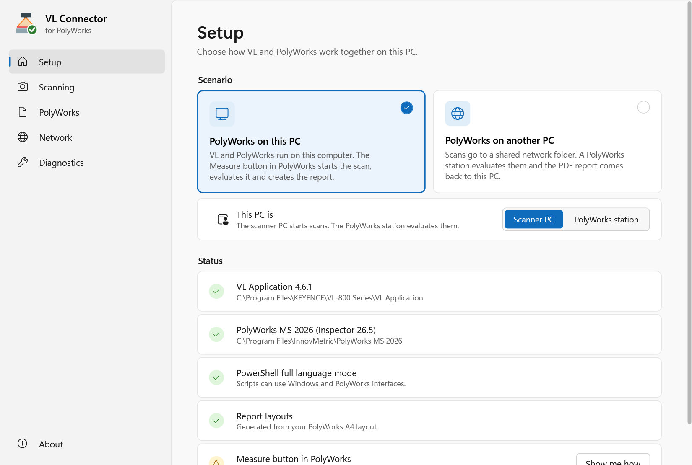
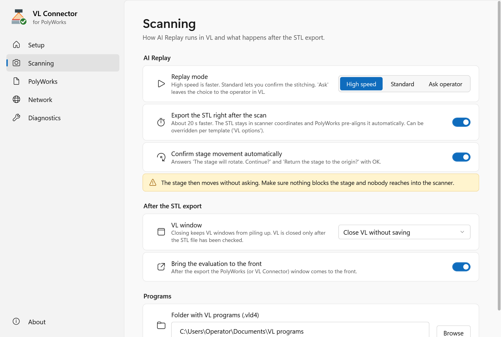
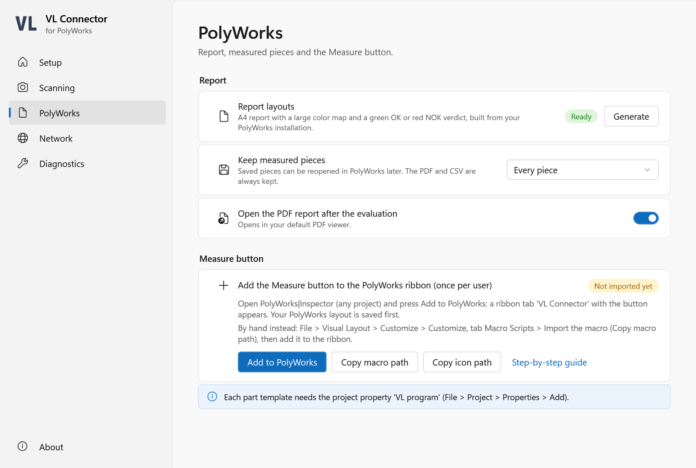
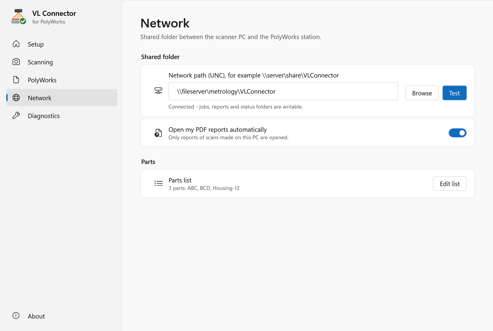

# VL Connector for PolyWorks - User Guide

VL Connector starts **AI Replay** in the KEYENCE VL Application, exports the scan as an STL file and has
**PolyWorks|Inspector** evaluate it against the part template: alignment to the CAD, all controls of the
template, a color map and an A4 PDF report with a green **OK** or red **NOK** verdict, plus a CSV table.

> Unofficial tool - not an official KEYENCE or InnovMetric product and not covered by their warranty or
> support. KEYENCE, VL-800 and PolyWorks are trademarks of their respective owners.

## Contents

1. [Scenarios](#1-scenarios)
2. [Installation](#2-installation)
3. [The settings window](#3-the-settings-window)
4. [Part templates in PolyWorks](#4-part-templates-in-polyworks)
5. [Scenario A: the Measure button](#5-scenario-a-the-measure-button)
6. [Scenario B: network folder, station and agent](#6-scenario-b-network-folder-station-and-agent)
7. [Options per part](#7-options-per-part)
8. [Troubleshooting](#8-troubleshooting)
9. [Support](#9-support)

## 1. Scenarios

**A - PolyWorks on the scanner PC.** The operator opens the part template in PolyWorks|Inspector and presses
**Measure**. VL starts AI Replay for the part; the operator scans as usual. After the last position the STL
goes straight to PolyWorks, which evaluates it and shows the verdict and the report.

**B - PolyWorks on another PC.** The scanner PC has only VL and VL Connector. The operator scans with AI
Replay in VL as usual; the VL Connector **agent** in the background exports the STL and sends it to a shared
network folder. A **PolyWorks station** evaluates it with the template of the VL program, and the PDF report
comes back and opens on the scanner PC - only the reports of scans made on that PC.

## 2. Installation

You need Windows 10 or 11, the VL Application 4.6 with its **English** user interface (scanner PC) and
PolyWorks Metrology Suite 2026 (evaluating PC). No administrator rights are needed, and nothing is copied into
the program folders of VL or PolyWorks (VL Connector is not a PolyWorks plug-in).

1. Check that the SHA-256 of the downloaded ZIP matches `SHA256SUMS.txt`:
   `Get-FileHash .\VLConnector-1.0.0.zip` in PowerShell.
2. Extract the ZIP (right click > Extract All) and double-click **Install.cmd**.
3. The installer checks every file against its manifest and shows the **package fingerprint**. Compare it with
   the fingerprint you received with the package, then confirm.
4. It installs to `C:\ProgramData\VLConnector` (another folder: `Install.cmd -InstallDir D:\VLConnector`),
   builds the report layouts from your PolyWorks installation, creates the PolyWorks button files and the
   Start menu entries **VL Connector** (settings), **VL Connector agent** and **Uninstall VL Connector**.

5. At the end it offers the **setup wizard** (also later: settings window > Setup > *Setup wizard*). The wizard
   asks for the scenario and the main options, builds the report layouts, **adds the VL Connector tab with the
   Measure or Station button to PolyWorks** (open PolyWorks|Inspector first; your PolyWorks layout is saved
   before and the wizard can undo it) and, for the network scenario, sets the shared folder and the agent.

**Update:** run Install.cmd of the new version. Settings, report layouts and the imported PolyWorks buttons stay.
**Check an installation:** `Install.cmd -Verify` (in the program folder) compares all files with the manifest
and shows the status of the PC. **Uninstall:** Start menu > Uninstall VL Connector. Scans, reports and
PolyWorks projects are never removed.

## 3. The settings window

Start menu > **VL Connector**. Every change is saved immediately ("Saved" appears at the bottom).



| Page | What you set |
|---|---|
| **Setup** | Scenario A or B; in scenario B whether this PC is the scanner PC or the PolyWorks station. The status list checks this PC and offers the next step (for example *Build* for missing report layouts). **Setup wizard** runs the guided setup again. |
| **Scanning** | AI Replay mode (High speed, Standard, or let the operator choose in VL), export right after the scan, automatic confirmation of the stage movement, what happens to the VL window after the export, where VL programs are. |
| **PolyWorks** | Report layouts, which measured pieces to keep, opening the PDF, the Measure (or Station) button. |
| **Network** | The shared folder (scenario B), opening reports automatically, the agent (start with Windows), the programs list. |
| **Diagnostics** | Log folder, a support ZIP, versions. |

### Scanning options in detail

- **Replay mode** - *High speed* is faster; *Standard* lets you confirm the stitching in VL; *Ask operator*
  leaves the choice to the operator in VL's own dialog.
- **Export the STL right after the scan** - about 20 s faster: the STL is exported in scanner coordinates and
  PolyWorks pre-aligns it automatically. Switch it off to export after VL's own CAD alignment.
- **Confirm stage movement automatically** - answers *The stage will rotate. Continue?* and *Return the
  stage to the origin?* with OK. **Safety:** the stage then moves without asking; make sure nothing blocks it
  and nobody reaches into the scanner.
- **VL window after the export** - *Leave VL open*, *Minimize VL*, *Close VL without saving* or *Save VL data
  (.vld4), then close*. VL is closed only after the exported STL has been checked again (complete binary
  STL with the exported number of triangles); otherwise VL stays open and the log says why. VL is never
  terminated forcibly.
- **Bring the evaluation to the front** - scenario A: after the export the PolyWorks window comes to the front.



## 4. Part templates in PolyWorks

Each part needs a **template project** in a PolyWorks workspace: the CAD model, the features and comparison
points with their tolerances (the controls), as for any PolyWorks inspection. VL Connector measures **all
controls** of the template and aligns the scan by automatic pre-alignment plus best-fit to the CAD.

Add these **project properties** to the template (File > Project > Properties > Add):

| Property | Required | Value |
|---|---|---|
| `VL program` | yes (scenario A) | Path to the AI Replay program of the part (`.vld4`). |
| `VL options` | no | Options for this part, e.g. `-Mode Standard` - see [Options per part](#7-options-per-part). |
| `VL reports` | no | Folder for PDF and CSV of this part (otherwise the workspace folder `Reports`). |
| `VL test STL` | no | Path to an STL: the Measure button evaluates it without scanning (to try a template). |

Save the template afterwards. Every measured piece is a **copy** of the template named
`<template>_<date>_<time>`; the template itself is never changed. The piece gets the property `VL template`,
so pressing Measure in an open piece starts the next part from the template again.

**Report:** page 1 shows a large isometric color map with the verdict (green OK / red NOK) and the summary,
page 2 the table of all controls, then top and front views. The CSV has one line per control with nominal,
measured, deviation, tolerances and result. The verdict is NOK when a control is out of tolerance or could not
be measured.

## 5. Scenario A: the Measure button

### Add the button to PolyWorks (once per Windows user)

Automatically: open PolyWorks|Inspector (any project), then press **Add to PolyWorks** in the setup wizard or in
the settings window, page **PolyWorks**. A ribbon tab **VL Connector** with the **Measure** button appears. Your
PolyWorks visual layout is saved before (in `%LOCALAPPDATA%\VLConnector\polyworks-layout`); the wizard can undo it.

By hand instead:

1. In the settings window, page **PolyWorks**, press **Copy macro path**.
2. In PolyWorks|Inspector open **File > Visual Layout > Customize > Customize**.
3. Tab **Macro Scripts** > **Import**, paste the path (`...\VLConnector\VLC_Measure_Button.pwmacro`) and confirm.
4. Tab **Customize Ribbon** (or Quick Access Toolbar) > choose **Macro Script Files** > select
   **VLC_Measure_Button** > **Add**. As icon, use the file from **Copy icon path** (`VLC_icon_32.png`).

The button only calls the installed macro, so updates of VL Connector need no new import.



### Measuring

1. Open the part template (or the last measured piece of the part) in PolyWorks|Inspector.
2. Press **Measure**. A progress window shows what VL is doing; **Cancel** stops the measurement in PolyWorks.
   AI Replay in VL is not stopped by it: finish or close it in VL.
3. Scan the part in VL as usual (place the part, press Measure in VL for each position).
4. After the last position the STL is exported, PolyWorks evaluates it (about 15-30 s) and shows the verdict.
   The PDF opens if this is switched on.

**Keep measured pieces** (page PolyWorks): *Every piece*, *Only NOK pieces* or *None* - the PDF and CSV are
always kept. Pieces that are not kept are removed from the workspace after the report is created.

## 6. Scenario B: network folder, station and agent

The operator on the scanner PC works **in VL as usual**: AI Replay, choose the program (.vld4) in VL, scan.
The **VL Connector agent** waits in the background and does the rest: after the last position it exports the
STL (named `<program>_<date>_<time>.stl`), sends it to a shared folder, and opens the PDF report when the
PolyWorks station has evaluated it.

### Shared folder

Create a folder on a file server, e.g. `\\fileserver\metrology\VLConnector`, that the Windows users of the
scanner PCs and of the station can **read, create, change and delete files** in. In the settings window of
every PC: page **Setup** > *PolyWorks on another PC*, page **Network** > enter the folder > **Test**.
VL Connector creates the subfolders `jobs`, `work`, `reports`, `processed`, `failed` and `status`.

### Programs list

The station finds the PolyWorks template of a scan by its **VL program**. Page **Network** > **Edit list**
opens `programs.csv` in the shared folder. One line per VL program, separated by semicolons; the first line is
the header:

```
Program;Workspace;Template
ABC;D:\PolyWorks\Parts\Parts.pwk;ABC
Housing-12;D:\PolyWorks\Parts\Parts.pwk;Housing12
```

- `Program`: the name of the AI Replay program, i.e. the `.vld4` file name without `.vld4`.
- `Workspace` and `Template`: the PolyWorks workspace on the **station** and the template project in it.

### The agent (scanner PC)

On the scanner PC set the role **Scanner PC** (page Setup). On page **Network**, switch on **Start the
agent with Windows** and press **Start now** once. The agent shows the VL Connector icon in the notification
area; its menu shows the state (waiting for AI Replay, station online or offline), opens the last report or
the reports folder, and can pause or end the agent.



Then scan as usual. After each AI Replay the agent:

1. exports the STL (with the options of page **Scanning**: right after the scan or after VL's alignment, and
   what happens to the VL window),
2. saves it in `Documents\VL Connector\Scans` and sends it to the shared folder - if the folder is not
   reachable, it waits in a local outbox and is sent automatically later,
3. shows a notification when the station has evaluated it (**OK** / **NOK**) and opens the PDF (setting *Open
   my PDF reports automatically*). Reports are saved in `Documents\VL Connector\Reports`.

Only reports of scans made on this PC are opened. An AI Replay started by the Measure button of scenario A is
never exported twice.

### The PolyWorks station

On the station PC choose **PolyWorks station** in the setup wizard (or page Setup). Then, once, with
PolyWorks|Inspector open: **Add to PolyWorks** in the wizard (or page PolyWorks) adds the tab **VL Connector**
with the **VL Station** button (by hand: import `VLC_Station_Button.pwmacro` like the Measure button).

To run the station, open a PolyWorks|Inspector **used only for the station** (from the Workspace Manager as
usual) and press **VL Station**. A small window shows the shared folder, the last job and a **Stop** button.
The station takes the scans one by one, opens the template of the VL program from the programs list, evaluates
the scan and sends the report back; it uses the PolyWorks settings of the station PC (keep pieces, report
layouts, color scale). Keep the station PC logged on (a locked screen is fine) while scanning.

## 7. Options per part

The template property `VL options` (scenario A) overrides the settings for one part. (In scenario B the
operator starts AI Replay in VL, so the settings of the scanner PC apply.) Use any of:

| Option | Values |
|---|---|
| `-Mode` | `HighSpeed`, `Standard`, `Ask` |
| `-ExportImmediately` | `On`, `Off` |
| `-ConfirmStageMotion` | `On`, `Off` |
| `-AfterExport` | `None`, `Minimize`, `Close`, `SaveAndClose` |
| `-ReturnFocus` | `On`, `Off` |
| `-TimeoutMin` | minutes to wait for the scan (default 45) |
| `-SettleSec` | seconds to wait before the export (default 2) |
| `-NewWindow` | always open a new VL window |

Example: `-Mode Standard -AfterExport Minimize`. An unknown option stops the scan with a clear message.

## 8. Troubleshooting

| Message or problem | What to do |
|---|---|
| *The scanner is not connected* | Check the scanner cable and power, then start again. |
| *Another scan is running on this PC* | Finish or cancel the AI Replay in VL first. |
| *Project ... has no VL program* | Add the project property `VL program` to the template (section 4). |
| *VL Connector could not start* (in PolyWorks) | Open the settings window: the Setup page shows what is missing. |
| *PowerShell runs in ConstrainedLanguage mode* | Ask IT: VL Connector needs FullLanguage mode (see Notes for IT). |
| *Template ... could not be opened* | The template name or workspace is wrong, or the template is open in another PolyWorks. |
| The report uses the plain PolyWorks layout | Page PolyWorks > Report layouts > **Build**. |
| Scenario B: no STL after AI Replay | Is the agent running (icon in the notification area)? Settings > page Network > Start now. |
| Scenario B: *station offline* in the agent menu | Start the station (VL Station button) and check the shared folder on the station PC. |
| Scenario B: no report arrives | The station is busy or stopped; the scan is evaluated as soon as it runs. |
| Scenario B: *not in the programs list* | Add the VL program (the .vld4 name without extension) to `programs.csv`. |
| VL does not react to VL Connector | VL must show its English user interface; close extra dialogs in VL. |

Logs: `%LOCALAPPDATA%\VLConnector\logs` (page Diagnostics > Open folder), one file per day and part of
VL Connector, kept for 30 days.

## 9. Support

Contact your local sales engineer, who forwards questions to the local technical team. Please attach the
support ZIP: settings window > **Diagnostics** > **Create ZIP** (logs, settings, status and file list; no
scans or reports).
